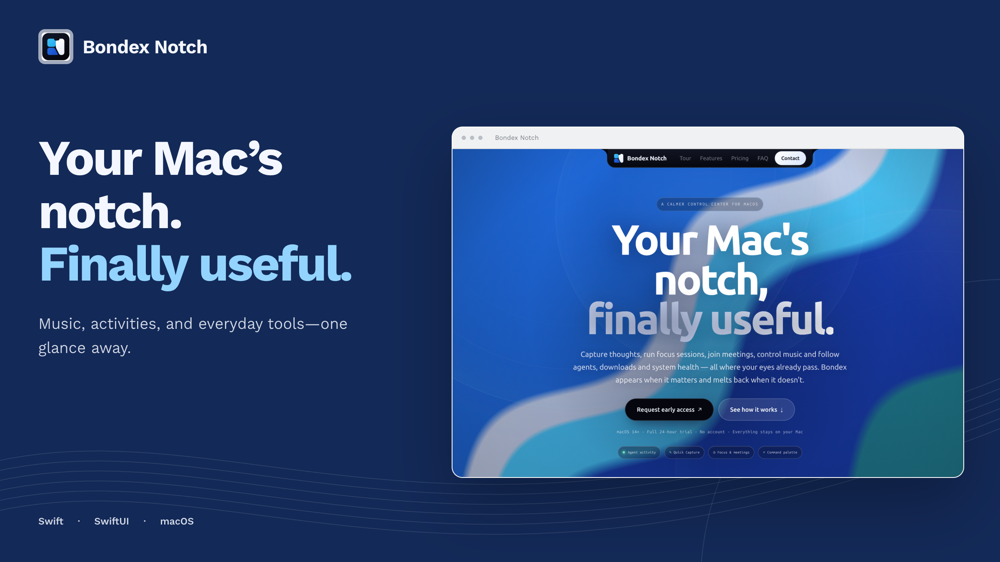
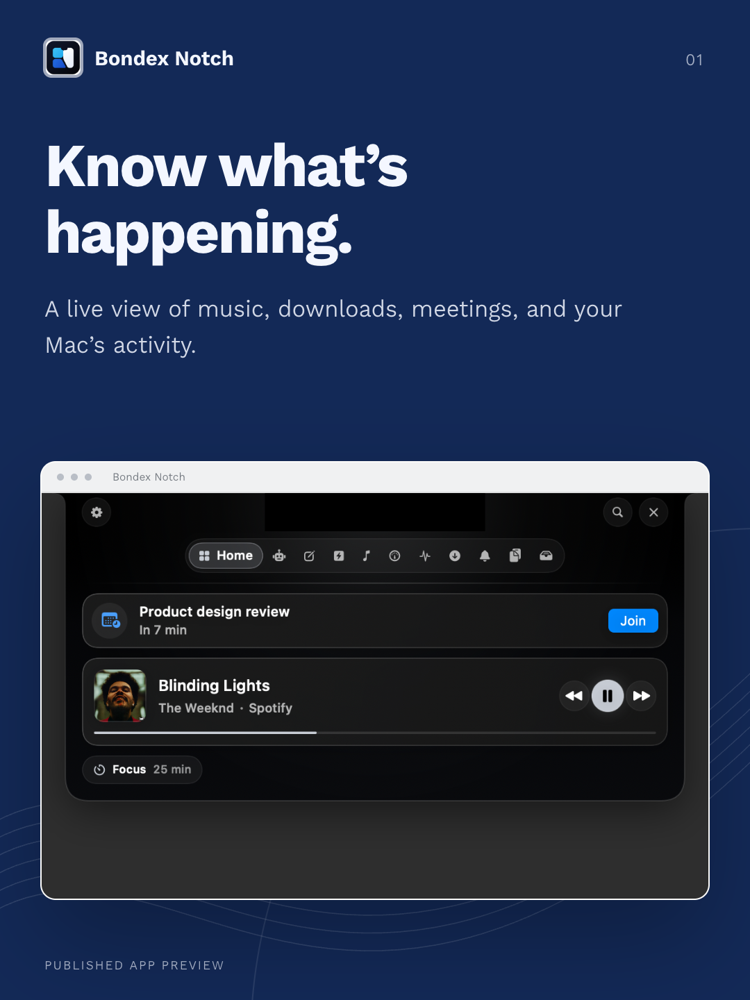
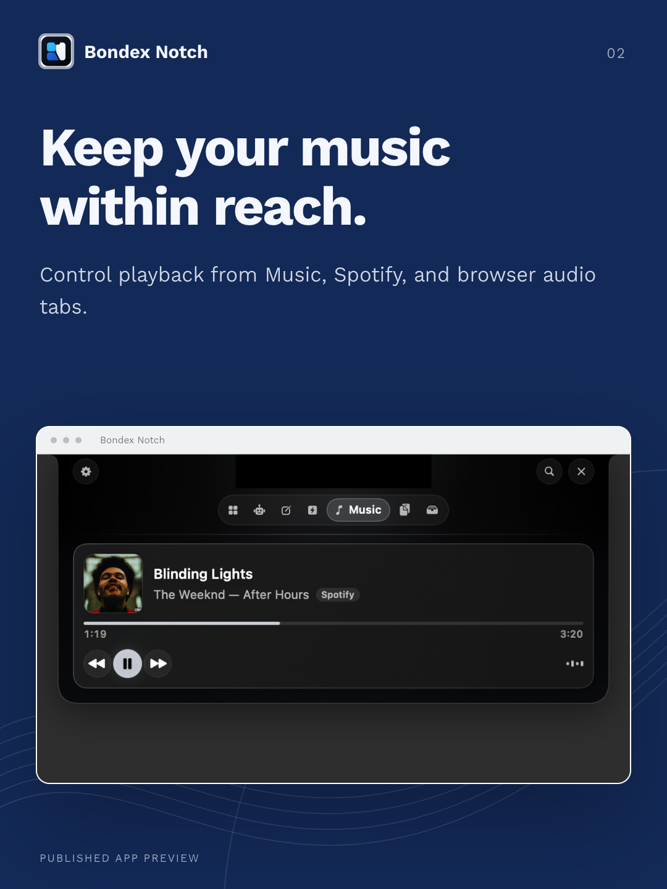
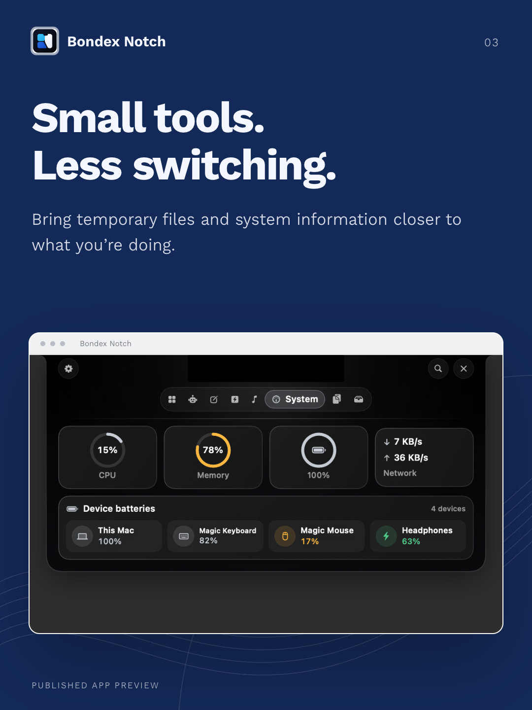

# Bondex Notch

A native macOS productivity utility that turns the display notch into a live,
Dynamic Island-style surface — and the site that sells it.

| Directory                               | What it is                                                           |
| --------------------------------------- | -------------------------------------------------------------------- |
| [`bondex-notch-app`](bondex-notch-app/) | The macOS app. Swift 6, SwiftUI, AppKit, no dependencies.            |
| [`bondex-notch-web`](bondex-notch-web/) | The marketing site. Next.js 16, React 19, TypeScript, static export. |
| [`docs`](docs/)                         | Original project proposal.                                           |

<!-- product-images:start -->

## Product preview

<p align="center">
  
</p>

<table>
<tr>
  <td width="33%"></td>
  <td width="33%"></td>
  <td width="33%"></td>
</tr>
</table>

<!-- product-images:end -->

## Quick start

```bash
cd bondex-notch-app && ./scripts/build-app.sh release && open "build/Bondex Notch.app"
```

```bash
cd bondex-notch-web && npm install && npm run dev
```

Each directory has its own README with architecture notes and caveats. Two
points worth knowing up front, both covered in detail in
[the app README](bondex-notch-app/README.md):

- Media is read from the playing app itself, because macOS exposes no public
  system-wide Now Playing API: Music and Spotify over their scripting
  dictionaries, browser tabs by evaluating a small script in the tab that owns
  the audio. Web players need "Allow JavaScript from Apple Events" enabled once
  per browser; the panel says so when it is still off.
- The "Activity" widget is a feed of events Bondex observes itself. No Mac app
  can read other applications' notifications.

Requires macOS 14 or later and Xcode 16+ to build.
